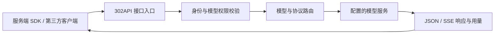

# 对外技术能力与边界

## 接入结构

此图是对外接入关系，不公开生产内部拓扑、地址、密钥或安全配置。

## 协议能力

| 能力 | 入口 / 形式 | 条件 |
|---|---|---|
| 模型列表 | `GET /v1/models` | 使用当前 Key 的权限范围 |
| 聊天 | `POST /v1/chat/completions` | 模型及渠道支持 OpenAI 兼容聊天 |
| Responses | `POST /v1/responses` | 模型及路由支持 Responses |
| Embeddings | `POST /v1/embeddings` | 选择支持向量功能的模型 |
| 原生 Anthropic | `/v1/messages`、`/v1/messages/count_tokens` | 支持原生协议的模型 / 渠道 |
| 图像生成与编辑 | 启用模型对应的图像或聊天路径 | 具体模型、输入格式、模态与路径分别确认 |
| 流式输出 | SSE | 模型和接口支持，调用端正确读取事件流 |
| 工具调用 / 缓存 | 相应协议参数 | 各模型及客户端兼容范围不同 |

这些是接口类别，不能把路径存在解释成所有模型均能使用。工具调用参数、图片输入和图片生成也是不同能力。

## 模型与价格

- 真实模型 ID、可用范围和售价以 [模型页](https://302api.com/models)、控制台及用户实际配置为准。
- 公开参考价格与本站售价属于不同字段；缓存、模态、长上下文或分时规则可能影响最终计价。
- 预留余额是处理请求期间的资金占用，不等于已经发生的实际消费。
- 最终账单需要可核对的用量与对应规则，页面格式化价格不能代替内部结算精度。

本阶段不公开完整计费算法、账务数据库或生产支付实现，也不在示例中固定优惠折扣与活动时间。

## Key 与客户端

用户用自己的本站 Key 访问本站入口，不需要在客户端配置本站的上游密钥。每个客户端的认证字段、Base URL 拼接规则和模型能力声明可能不同，按对应配置教程处理。

Key 的额度、启停、允许模型和账户状态会影响调用结果。不要从“客户端能保存配置”推断认证已经通过。

## 状态与 SLA

[服务状态](https://302api.com/status/) 展示的厂商信息与本站观测不是同一个口径；可用性统计与 SLA 承诺也需要分别理解。请参考 [SLA 页面](https://302api.com/sla/) 当前规则。

这个开发者仓库不提供实时状态副本、不生成历史正常样本，也不以示例中的状态组件证明服务可用。

## 公开范围与透明度

本仓库公开的是文档、示例、客户端配置与独立组件。它可以帮助开发者审阅如何接入、环境变量如何使用以及示例是否包含敏感行为；它不等于完整服务端源代码或线上运行版本证明。

依赖与第三方客户端的使用范围以其各自文档和许可证为准。请求兼容不表示获得对应厂商的官方订阅、授权背书或全部产品权益。
